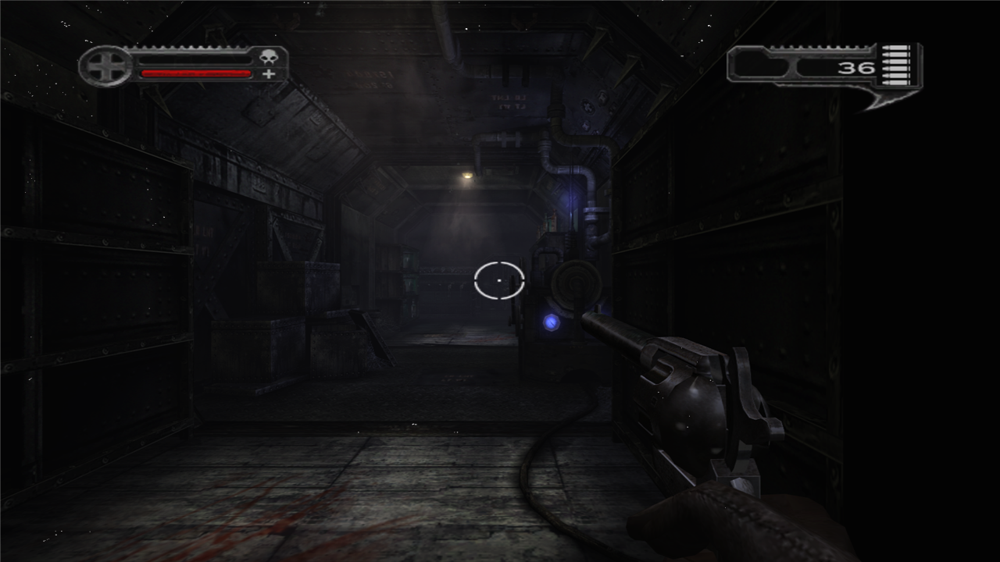
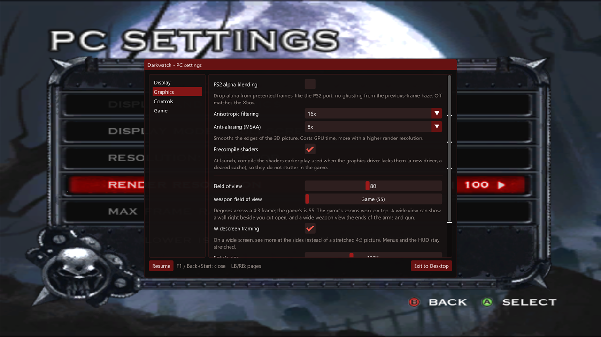

# Arizona Vamp Recomp

**A native PC port of *Darkwatch* (original Xbox, 2005), made by static recompilation.**

The game's Xbox executable is translated ahead of time into native x86-64 code. Its graphics and sound calls are
answered by modern APIs: Direct3D 8 runs on **Direct3D 12**, DirectSound on **XAudio2**. Nothing is emulated at
run time, so the game runs at full speed with PC features layered on top: real display modes, render scaling,
keyboard and mouse, and an in-game settings menu.

> **No game data is included.** You need your own copy of Darkwatch for the original Xbox.
> This project is not affiliated with or endorsed by the game's publisher or developer.

<p align="center">
  
  
</p>

## Status

**Early, but playable into the first level on Windows.** The game boots, plays its movies, and goes through the
front end and briefing into the first level (THE WRONG TRAIN). There it runs at 60 fps with sound, lighting, fog and
the HUD close to the console. A full play-through has not been done yet; that is the next big step.

| Platform | State |
|---|---|
| **Windows 10/11 x64** | Main target. Builds natively; reaches and plays the first level. |
| macOS (Apple silicon) | Later. A headless test harness builds and reaches PRESS START. |
| Android | Later. |

Day-to-day progress, findings and open bugs are in [STATUS.md](STATUS.md).

## Features

**Runs natively**
- Statically recompiled game code: no CPU emulation, no JIT.
- Direct3D 12 renderer with a **shader disk cache**: shaders compile once, later runs load without hitches.
- **Shader pre-compile at launch:** the pipelines earlier play used are kept for your graphics driver. When the
  driver changes (or the cache is cleared) they compile again at launch behind a progress bar, with **Skip**
  and **Don't show this again** (turn it back on under PC settings, Graphics).
- XAudio2 sound, including the game's XACT audio.

**PC settings menu**, in game: press **F1**, press **Back + Start** on a controller, or pick **PC SETTINGS**
in the pause menu or the main menu's OPTIONS (it replaces the Xbox Live entry).
- **Display:** fullscreen / borderless / windowed, resolution, render resolution 25-200%, frame-rate cap, V-Sync.
  A new display mode asks to be kept and goes back after 15 seconds.
- **Graphics:** anisotropic filtering (16x by default), optional *PS2 alpha blending* (removes the
  previous-frame ghosting that the Xbox version has).
- **Controls:** keyboard and mouse on or off, mouse look and sensitivity, key rebinding.
- **Game:** frame-rate counter.
- Changes apply at once and are saved to `settings.toml`. Exit to Desktop is one click away.

**Input**
- Controllers work as on the console.
- Full keyboard and mouse support for player 1, with raw mouse look and rebindable keys.

**For testers**
- **F4** opens a bug-report box: type what you saw, and a folder with your note, a frame capture, the log tail and
  your settings is saved to `reports\`.
- **F3** captures a frame (every draw call, render target and shader) for debugging.

**Fixes over a straight port**
- Fog-streak fix in the meat-locker corridor (the game's own screen-space texture scale, patched).
- Xbox Live entries turned into the PC settings menu.

## Installing (Windows)

1. Download the zip from the [latest release](https://github.com/Clergyman0013/arizona-vamp-recomp/releases) and
   unpack it anywhere (about 3 GB free needed).
2. Put your game in the `assets` folder: your disc image (`.iso`), or `default.xbe` with the game's folders beside it.
3. Run `Darkwatch.exe`. The first start builds the game's code for your PC from your own copy, behind a progress
   window. That takes a while and happens only once; after it, the game starts straight away.

The release contains no game code: it ships the recompiler and a compiler (Clang and LLD) instead, and the game is
built on your PC from your files, as in [BLACK-XBERecomp](https://github.com/TGP482/BLACK-XBERecomp).

## Building from source (Windows)

You need:
- Windows 10 or 11, 64-bit, and a GPU with Direct3D 12.
- [Visual Studio 2022](https://visualstudio.microsoft.com/) (Community is fine) with **Desktop development with C++**.
  `build.bat` offers to add the Clang and CMake components it needs.
- [Git](https://git-scm.com/download/win).
- Your own Darkwatch game files: `default.xbe` and the folders beside it, from your disc.

```bat
git clone https://github.com/Clergyman0013/arizona-vamp-recomp.git
cd arizona-vamp-recomp

rem the recompilation SDK, at the tested commit, with this project's patch
git clone https://github.com/TGP482/XboxXBERecomp.git third_party\XboxXBERecomp
git -C third_party\XboxXBERecomp checkout 99078b1
git -C third_party\XboxXBERecomp apply ..\..\patches\xboxxberecomp-darkwatch.patch

rem copy default.xbe and the game's folders into darkwatch-hle\assets\, then:
darkwatch-hle\build.bat
```

The first build recompiles the game and takes **30 to 90 minutes**; later builds take a few minutes. The result
is `darkwatch-hle\out\build\release\Darkwatch.exe`, with the game code in `Darkwatch.dll` beside it. `build.bat`
offers to start it when it is done. `darkwatch-hle\release.bat` then makes the release zip (it needs
[7-Zip](https://www.7-zip.org/)), without the game code.

If CMake fails while fetching its dependencies (some PCs with Mandatory ASLR on cannot run Git's shell scripts),
run `darkwatch-hle\tools\deps_windows.bat` once, then `build.bat` again.

## Playing

Run `Darkwatch.exe`. Settings live in `settings.toml` beside it, written on the first run; the menu edits it for
you.

| Key | Action | Key | Action |
|---|---|---|---|
| W A S D | move | Mouse | look |
| Left click | fire | Right click | left trigger |
| Space / Enter | A (jump, select) | E / Backspace | B (back) |
| R / Q | X / Y | C / F | black / white |
| Left Shift | left stick click | Middle click / V | right stick click |
| Arrow keys | d-pad | Escape / Tab | Start / Back |
| **F1** | PC settings menu | F2 | free / take the mouse |
| F3 | frame capture | **F4** | report a problem |

The full list, with the key names `settings.toml` accepts, is in
[README-release-windows.txt](darkwatch-hle/tools/README-release-windows.txt).

## Roadmap

The quality bar is [BLACK-XBERecomp](https://github.com/TGP482/BLACK-XBERecomp), built on the same SDK.
The full list is in [ROADMAP.md](ROADMAP.md). In short:

1. **Play-through QA:** play the whole game, file F4 reports, fix as they come.
2. **More PC options:** field of view and viewmodel FOV, monitor choice, MSAA / SMAA, draw distance,
   FMV scaling, pause on focus loss, mouse invert, HDR10.
3. **Polish:** a native EXIT TO DESKTOP entry in the game's own menus, hide the leftover Xbox Live notices,
   background shader compiles so even the very first run does not stutter.
4. **More platforms:** macOS, then Android.

## How it works

1. The SDK lifts every function in `default.xbe` to C++ (the `generated/` code, never committed: it is derived
   from the game) and builds it into `Darkwatch.dll`. A release does this on the player's PC on its first start.
2. The Xbox kernel and the XDK libraries (Direct3D 8, DirectSound, XInput, file system) are replaced by high-level
   implementations on Windows APIs. `config/game.toml` names the XDK functions inside the game.
3. Game-specific fixes hook single recompiled functions (`darkwatch-hle/src/game/`), and the PC menus sit on the
   SDK's ImGui layer (`darkwatch-hle/src/common/`).
4. Changes to the SDK itself are kept as one patch, [patches/xboxxberecomp-darkwatch.patch](patches/xboxxberecomp-darkwatch.patch),
   with each change explained in [patches/README.md](patches/README.md).

## Repository layout

```
darkwatch-hle/          the port (main line)
  src/common/           PC settings menu, bug-report box, game settings
  src/game/             game-specific hooks and fixes
  config/game.toml      XDK symbols found in the game
  tools/                build helpers, QA scripts, release notes
darkwatch/              the older xboxrecomp-based port, kept as a reference (docs/xboxrecomp-port.md)
patches/                changes to the two toolkits, as patches against upstream
references/             reference screenshots: console captures and the port's progress
STATUS.md               current state, findings and open bugs
BRINGUP.md, PLAN.md     bring-up history and decisions
```

## Contributing

Bug reports are welcome. The most useful report is an **F4 report folder** (zip it) with what you expected to see;
see [CONTRIBUTING.md](CONTRIBUTING.md). Please do not attach game files or anything extracted from them.

## Credits

- [XboxXBERecomp](https://github.com/TGP482/XboxXBERecomp) by TGP482: the static recompilation SDK this port is built on.
- [BLACK-XBERecomp](https://github.com/TGP482/BLACK-XBERecomp): the quality bar.
- [xboxrecomp](https://github.com/sp00nznet/xboxrecomp) by sp00nznet: the toolkit behind the reference port
  (with parts from [xemu](https://xemu.app/), LGPL-2.1).
- [Dear ImGui](https://github.com/ocornut/imgui), [SDL](https://github.com/libsdl-org/SDL),
  [Zydis](https://github.com/zyantific/zydis), [toml++](https://github.com/marzer/tomlplusplus).
- High Moon Studios for making this classic. 

## Legal

This repository holds only original code, patches and documentation, under the [MIT license](LICENSE). It contains
no game code, game data or Xbox system software, and building it requires a legally obtained copy of the game.
*Darkwatch* and all related names and marks belong to their respective owners.
